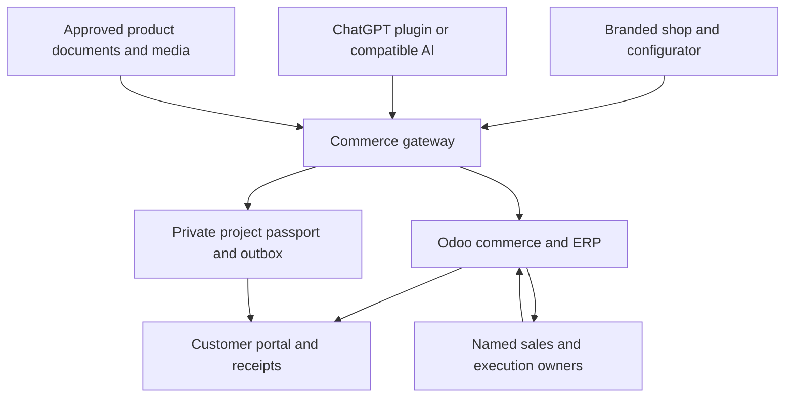

# PVLager / Solarcarport / VR — Agentic Commerce Blueprint

13 October 2026 · Decision proposal for Frank and his brother · German customer experience, English engineering contract

## The decision

Use Odoo as the commercial system of record and initial webshop. Add one small, governed commerce gateway for branded AI journeys, project continuity and expert handoff. Keep PVLager, Solarcarport.tech and VR Gebäudetechnik distinct at the customer surface. Reuse the gateway; do not create three inventories, payment stacks or agent platforms.

The customer promise is: **Ihr Projekt. Klar geplant. Fachgerecht umgesetzt.** Sell confidence in the next decision, dependable procurement and accountable execution. Characters make the process recognizable; named people and authoritative records make it trustworthy.

The first revenue release is a working inquiry-to-quotation flow and a dependable shop. The full vision is a customer-owned project passport that persists across AI conversations, devices, quotations, installation and future upgrades. The passport improves convenience and retention; exportability preserves trust.

## Verified starting position

| Evidence read in this session | Finding | Consequence |
|---|---|---|
| `frankxai/pv-lager-agentic`, main tree `ef594a2e69259eea26539b8b363997d084d455c6` | Documentation, seller prompt and HTML intake mock; no root application manifest or AGENTS.md | Recover deployed application source before modifying the real shop |
| Vercel `pv-lager-agentic` | Existing Next.js project; latest reported deployment READY and production; deployed August 2026 | READY describes deployment state, not functioning orders; connector response does not establish a clean Git-to-deployment link |
| `frankxai/solarcarport.tech`, main tree `72ff08f1c6937450ad14ce5dafd7f21486f74030` | Next.js storefront, configuration, sizing, partner widget and ERP drawer code exist | Reuse useful UI after capability and provenance review |
| `src/app/api/embed/lead/route.ts` in Solarcarport | Uses mockTenants, calculates an indicative BOM, generates an ID, logs personal/commercial data, and returns success; no persistent lead or delivery action in this handler | P0: persistent inbox + Odoo receipt + ownership; remove unsupported 24-hour and engineering-review promises; redact routine logs |
| PVLager draft PR [#3](https://github.com/frankxai/pv-lager-agentic/pull/3) | Solar Commercial OS architecture, contracts and skills-only plugin already prepared | Reuse its contribution metrics, authority model, canonical identifiers and three skills; this is unmerged specification, not an operating platform |
| PVLager draft PR [#13](https://github.com/frankxai/pv-lager-agentic/pull/13) | Multi-brand invoice kit and Odoo mapping guidance already prepared | Review against actual Odoo snapshots; do not build another invoice engine |
| Character concept and Social Strategy Edition 03 | KERN, RASTER, FUGE and TRAKT have distinct roles; prior art and social directions exist | Preserve recognizable forms and prior separation of legal sellers |
| Current first-party Odoo and OpenAI documentation | Odoo Online Custom enables external API; Odoo Online cannot run ordinary custom server modules; plugin UI and external checkout are available subject to review/category constraints | Use a narrow external gateway, native Odoo confirmation and merchant checkout; treat specialized native checkout/quote discovery as gated |

No Odoo tenant is connected in this session. Its actual version, hosting, company records, data quality, prices, stock and API credentials are unknown. The previous specification names weclapp as a transition source; its current operational status is not verified here. No company data has been migrated and no order, payment, customer contact or agent schedule has been activated.

The companion preview is a working local demonstration of routes, project drafting and economics. Its illustrations are concepts. It has no ERP calls or submission endpoint. It must remain visibly labelled as such when shown publicly.

## 1. Brand architecture and commercial ownership

| Surface | Primary buyer job | Proposed offer and primary action | Accountable owner |
|---|---|---|---|
| PVLager | Buy a specified component or a documented materials package | Published catalog, B2B purchasing, pallet/piece clarity, collection or shipment; **Material anfragen / Im Shop bestellen** | Named commercial lead; category and logistics owners |
| Solarcarport.tech | Turn an outdoor space into useful architecture and an energy project | Concept selection, site brief, options and expert planning; **Projekt prüfen lassen** | Named project advisor, then responsible planner |
| VR Gebäudetechnik | Deliver the agreed construction/building-services scope | Site assessment, approved work package, milestones, commissioning and handover; **Umsetzung besprechen** | Named execution lead and qualified specialists |
| Starlight Intelligence | Equip other businesses with the reusable commerce infrastructure | Licensed gateway, governed AI skills, integration and operation packs | Frank; each customer controls its tenant and data |

These are brand routes, not proof of shared legal ownership. Every published offer and quote must name the actual seller, billing company, delivery responsibility, warranty responsibility and, when applicable, installation contractor. A shared brand campaign does not create one combined contracting promise. Establish the real company map before enabling multi-company Odoo.

**Default for homeowners:** expert-led execution. Materials-only is a deliberate route for competent buyers and installers. VR is offered only where the real team has capacity, territory and qualifications. Else route to an approved local partner, naming the contractor before handoff. Do not imply that all installation is available everywhere.

## 2. Odoo versus GitHub and Vercel

| Capability | Odoo first | Thin extension | Hosting decision |
|---|---|---|---|
| Standard catalog, variants, price lists, stock, CRM, quotes, sales orders, invoices and portal | Yes, configure native apps | Project ID and provenance mapping | Odoo Online is the simplest managed baseline |
| Branded pages, real photos, simple forms and ordinary webshop | Yes; multiple sites where justified | Optional exported character media and simple navigation | Do not rebuild routine tax, shipping or checkout in Next.js |
| Customer portal and quote acceptance/payment | Prefer native Odoo flow | Signed links from gateway | Server recalculates commercial terms |
| Rich cross-brand configurator, portable project brief, versioned visualization | Limited native presentation may suffice initially | Reuse reviewed Solarcarport UI, project passport and render tools | Vercel optional for initial native shop; valuable for this extension |
| Public MCP, ChatGPT plugin UI, cross-client tools | Not provided by a skill alone | Business-specific allowlisted gateway over Odoo | Authenticated HTTPS deployment; Vercel can host short requests |
| Custom Python methods and complex transactional server extensions | Ordinary custom server modules cannot run on Odoo Online | Use Odoo.sh or managed/self-hosted Odoo when needed | Choose only after a demonstrated requirement; Odoo.sh hosting is extra |
| Versioned code, contracts, releases, review evidence and CI | Not ERP data storage | GitHub | Public repository contains generic code and synthetic data only |
| Durable retries and cross-system handoff | Native ERP jobs where available | One durable outbox/worker plus a small database | Avoid assuming a serverless request will finish a long job |

**Odoo-only is sufficient for the first reliable webshop. An Odoo MCP alone is insufficient for the proposed customer experience.** It still needs identity, business-specific policies, durable project state, receipts, approved documents and customer-safe tool boundaries. An unrestricted ORM MCP is a staff integration at most, never the public shop interface.

Confirm the actual Odoo version before implementation. Odoo 19 introduces JSON-2. Earlier versions need their supported adapters. Keep the adapter replaceable rather than binding every UI to one protocol.

The preferred MVP uses Odoo-native checkout and order confirmation. JSON-2 calls have separate database transactions. Do not implement reserve stock → confirm order → accept payment as unrelated remote writes. Use a single suitable Odoo operation or native workflow. When a custom atomic operation is essential, that is an Odoo.sh/self-hosting decision, not a prompt fix.

## 3. Target topology



Odoo owns customer commercial records, prices, stock, accepted orders and invoices. The gateway stores only the additional passport, source links, consent and execution/audit state it needs. Odoo IDs and external project/order keys connect records. A cached catalog is a dated projection, never a competing inventory.

One small business-owned EU database plus an outbox is enough initially. A separate CMS, vector store, warehouse and many persistent agents are not prerequisites. The prior Payload proposal remains an optional editorial expansion after Odoo content becomes a measured constraint. Reuse existing licensed infrastructure only with explicit company access boundaries.

## 4. Plugins and skills: three identities, one implementation

Prepare three branded customer packages: **PVLager Einkauf**, **Solarcarport Projektbegleiter**, **VR Projektübergabe**. Start by testing one end-to-end journey before submitting three listings. Each package supplies brand context, task-specific skills, an appropriate MCP surface and, where supported, small comparison/configuration UI. Shared backend code does not require shared seller identity.

The existing `assist-solar-customers`, `operate-solar-commerce` and `deliver-commercial-os` skills are a foundation. Skills define behavior; they do not provide live stock, authorization or an installed runtime. Public customer and private staff tools use distinct scopes and preferably distinct MCP registrations. Supplier costs, margins and purchasing analytics are never exposed through public tools.

| Proposed tool | Access | Contract |
|---|---|---|
| `catalog_search`, `product_get` | Published reads; authenticated price list when applicable | Exact SKU, document source/version, price basis, unit, stock timestamp; no internal cost |
| `project_draft_update` | Project owner; validated guest session where allowed | Versioned goals/options/dimensions and unresolved questions; persistent write |
| `render_project` | Authorized project | Concept image/schematic linked to a project revision; no change to technical approvals |
| `quote_prepare` | Own project/account or assigned staff | Server-priced draft; persisted creation is a write; no reservation claim |
| `project_submit`, `quote_submit` | Customer asks to submit; scoped identity/consent | Durable request, actual receipt and named queue; inquiry is not an accepted order |
| `own_order_get`, `project_status_get` | Server-verified ownership | Allowlisted status, documents and next action |
| `checkout_link_get` | Own valid draft/quote | Merchant-hosted checkout or Odoo portal link; expiry and seller shown |
| `commercial_brief`, `decision_execute` | Private staff membership and mandate | Reuse existing commercial contract; never arbitrary SQL or ERP model access |

Tool inputs never grant authorization. Bind brand, company, user and allowed price list on the server. A typed email, order number or tenant ID is insufficient. Anonymous users can browse published goods and draft a local brief. Private passport retrieval and mutation require a verified account or securely verified guest session. Enforce ownership again at every read and write.

Compatibility is client-specific: provide tool-only fallbacks and optional standard MCP Apps UI; OAuth capabilities, image display and registration vary across hosts. Do not claim every AI client renders the same interface.

Current OpenAI guidance supports merchant-hosted checkout for eligible physical goods. Embedded payment-sheet checkout is private beta; local-services Get Quote discovery is also partner beta. Those flows are optional later milestones. Do not make acquisition forecasts depend on automatic directory placement, search invocation or approval. Digital downloads/subscriptions should launch through your own website checkout; do not sell those inside a physical-goods plugin unless the platform explicitly enables the category.

## 5. The project passport

The durable unit is a **project**, not a chat session. Give the customer one project link and one clear next owner. Keep revisions instead of overwriting a prior quote silently.

Minimum record:

```json
{
  "schemaVersion": "1.0",
  "projectId": "opaque-server-id",
  "revision": 1,
  "brandContext": "solarcarport",
  "sellerCompanyId": "server-resolved",
  "ownerAccountId": "server-resolved",
  "intent": "expert_installation",
  "site": {"postcode": "customer-input", "dimensionsStatus": "unverified"},
  "goals": ["shelter", "ev_charging"],
  "selectedItems": [],
  "documents": [],
  "assumptions": [],
  "openQuestions": ["site survey", "structure", "electrical connection"],
  "technicalApproval": "not_reviewed",
  "commercialStatus": "draft",
  "odooReferences": {},
  "consentReceipt": null,
  "nextOwner": null
}
```

Real records also need attachment access controls, immutable evidence versions, upload scanning, retention, timestamps, calculation versions, idempotency keys and an event history. Store money in integer minor units. Keep piece/pallet/kit units explicit. Save quoted terms and their expiry; reprice at acceptance. Mark unverified dimensions and inferred inputs. Do not log customer photos, contacts or supplier economics into ordinary console logs.

Separate lifecycles: customer draft → submitted inquiry → assigned → technical review → commercial quotation → accepted → delivery/construction → handover → service. A payment event has its own lifecycle; an engineering approval has its own accountable reviewer. A green character expression cannot stand in for either.

## 6. Customer experiences

### A. Installer procurement: shortest path to repeat orders

Buyer: installer or qualified trade buyer with an actual bill of materials. They ask their AI: “Find the published module options for this purchasing brief; show pallet units, freight assumptions and documents.” The tool returns a small source-backed shortlist. The buyer selects exact SKUs and delivery mode. The server checks the applicable price list and current availability, then prepares an Odoo quote/cart. Acceptance and payment happen in the merchant flow. Reorders repeat the known bundle after stock/price revalidation. Do not silently substitute a technically different component.

Value: fewer emails, clearer unit handling, quicker repeat procurement and reduced error correction. This route is likely the fastest repeat-contribution engine; it is a hypothesis to validate against existing customers, not a measured segment ranking.

### B. Homeowner carport: expert-led transformation

Buyer: property owner with budget, outdoor space and interest in vehicle shelter, appearance and energy use. “40–60 and affluent” is a useful initial creative hypothesis, not a targeting truth. Segment by property control, site readiness, project budget, territory and purchase intent rather than age alone.

The opening shows what the space can become. KERN asks about use and available dimensions; the customer chooses one or two bays, charging interest, existing PV and delivery versus execution. A concept appears with unresolved site conditions. The customer can compare directions, save the project and submit a brief. A named human checks suitability, scope and site evidence. The quote clearly separates materials, engineering and construction responsibility. The portal shows milestones and handover documentation.

Use ordinary German: “Wir ordnen Ihre Wünsche und Unterlagen. Unsere Fachleute prüfen, was an Ihrem Standort passt.” Avoid “complete installation in minutes,” “guaranteed autonomy,” automatic structural approval or unsupported subsidy/savings statements. Ease concerns around understanding and coordination; do not simplify the physical work falsely.

### C. Commercial site and fleet

Buyer: owner/operator of a parking site, SME, hotel, apartment property or fleet. Start with spaces, location, use, operating constraints and project responsibility. Offer a human-reviewed feasibility discussion, phasing and an evidence request. A single lead can involve electrical capacity, civil works, charging operations and several decision makers. Do not reuse the consumer funnel unchanged or generate a binding large-site price from parking count alone.

### D. Aftercare and upgrades

The passport stores approved installed equipment, handover documents, warranty contacts and service records. The next offer follows verified installed compatibility and customer intent: EV charging, suitable storage, energy-management integration, a heat-pump discussion or another canopy. A heat pump is a separate system-design question. Availability and compatibility are checked again.

For a one-time homeowner project, repeat hardware purchases may be infrequent. Model LTV through legitimate upgrade contribution, service where offered and referrals. Installer replenishment has a different, shorter retention cycle. Never sell a recurring plan without recurring service value.

## 7. Characters, identity and interface craft

| Character | Customer-facing job | Visible behavior | Boundary |
|---|---|---|---|
| KERN | Selection and project clarity | Holds the relevant sample, reveals a short comparison, names the missing input | No certification or autonomous design authority |
| FUGE | Workmanship and readiness | Explains a drawing/site interface, shows milestones and handover objects | Actual qualified human owns execution |
| RASTER | Whole-property sequencing | Connects a carport decision to charging, heat and project phases | No fictional savings or universal compatibility |
| TRAKT | Machinery route only where relevant | Qualifies workload/access before choosing equipment | Keep AER machinery commercially distinct |

Preserve KERN’s canopy brow, warm rectangular eyes, mint center datum, matte aluminium, midnight-blue PV armor and copper stepped motif. Retain RASTER’s open-frame planner silhouette and FUGE’s grounded body, amber eyes, lime datum and tools. The generated campaign scene is a proposed extension, not a new approved logo or a real installation.

Use characters at selection, clarification, handoff and completion; do not cover product dimensions or fill every screen. Real product photos and authorized built-project evidence earn trust. Pair character illustrations with visible evidence labels. On quotations/invoices use a restrained identity treatment; legal seller and financial information lead.

Apply the established mineral ivory/deep pine/mint/copper campaign palette as a shared world, while preserving the Solarcarport application's existing graphite/amber architecture direction unless a specific redesign is accepted. Use readable solid surfaces, generous spacing, 44px targets and large German labels. Respect reduced motion. Lazy-load character artwork; no compulsory video, WebGL scene or animation before a customer can request a quote. Target good Core Web Vitals and verify on realistic mobile devices.

## 8. Human and agent responsibility

Agent roles are bounded jobs with explicit inputs, output contracts and receipts. Start with one orchestrator/worker, not eight always-running models. Names in the prior character material describe proposed roles, not verified legal authority or assigned runtime.

| Responsibility | Agent work | Human accountability | Release evidence |
|---|---|---|---|
| Migration | Mapping, dry-run comparison, deltas and reconciliation report | Business owner + ERP lead | Counts, values, open work and balances agree; rollback rehearsed |
| Catalog | Published field normalization, missing datasheets and price/stock freshness | Category owner | Exact SKU/UoM, approved claims and dated source |
| Customer intake | Minimal questions, passport revision, evidence collection | Sales lead | Customer can correct/export; no lost revisions |
| Quote preparation | Structured draft, arithmetic through service, freight assumptions | Assigned seller | Odoo receipt, seller and current commercial terms |
| Technical review | Assemble documents and unresolved checks | Qualified engineer/installer | Named review record and applicable scope |
| Follow-up | Draft or dispatch an allowed transactional response; track next action | Sales owner | Valid communication mandate; delivery status and exceptions |
| Delivery/construction | Checklist drafts and status synchronization | Logistics and execution leads | Real stock/order/job evidence; handover receipt |
| Maintenance/QA | Monitor failed jobs, integration drift, auth, backups and regressions; propose fixes | Frank or contracted operator | Tested preview, rollback, alert delivery and restore drill |
| Content/community | Source-backed education, captions, edit proposals | Publisher + technical reviewer | Approved real evidence, rights and destination |

AI may autonomously normalize data, run checks and prepare drafts within its configured access. Price changes, buying, new campaign spend, engineering approval and mass outreach need the applicable business mandate. Use existing authority when available; avoid repetitive approval for authorized routine work. Escalations always have a named queue and due-state. No response-time promise precedes an agreed staffing SLA.

## 9. Migration and production release

Separate three releases: webshop/domain transition, ERP authority cutover, and AI-write activation. Replacing all at once hides the cause of a failure.

1. Inventory active systems and ownership: Wix/Ionos and actual ERP, domains, email, payment providers, open orders and customer channels. Confirm renewal/expiry dates rather than relying on historic conversation dates.
2. Export protected backups and record canonical external IDs; stage Odoo mappings for SKUs, units, variants, kits, taxes, price lists, contacts, suppliers, open orders/POs, reservations, returns, invoices and payment allocations.
3. Pilot a deliberately narrow launch category and one carport inquiry. Prefer 10–20 clean hero SKUs over importing unreliable catalog claims.
4. Rehearse data import; reconcile quantities, financial balances and open work. Run old system as authority while Odoo shadows it. Do not leave two order writers active.
5. Preserve URLs, media rights, downloadable documents, redirects, legal seller pages, email and payment connectivity. Verify customer portal quote links use the intended brand domain.
6. Complete a real test inquiry with persistence/receipt and a sandbox order through payment, ERP, fulfillment state and invoice; exercise a retry and a failed handoff.
7. Record final delta and cutover boundary, disable former writes, switch authority and monitor reconciliation. Rollback plan must handle orders created after cutover, not only restore an old database.
8. Activate public/customer AI writes after ownership and idempotency tests. Expand only once actual sales and operational data demonstrate a benefit.

Production acceptance includes: no false successful submissions; no duplicate commercial orders under retries; clear stock timestamps; customer/company isolation; no private economics through public tools; price/tax/freight recalculation; durable outbox and reconciliation; accessible mobile journeys; actual alert and recovery ownership; authentic evidence and seller identity.

## 10. Time and cost

These are engineering estimates and internal budget envelopes, not vendor quotes or measured company performance. Access, data quality and team availability control elapsed time. App-directory review and merchant-beta approvals have no promised date.

| Release | Planning window after required access | Person-effort assumption | Valuable outcome |
|---|---|---|---|
| Reliable Odoo-native pilot | 3–5 focused workdays | 25–50 hours | One category and expert inquiry work through real staff/ERP |
| Thin gateway + passport + private plugin pilot | Next 1–2 focused weeks | Additional 30–60 hours | Same verified journey from shop and one compatible AI host |
| Broader platform and reviewed partner pilots | Approximately 6–10 weeks total, conditional | Additional 90–180 hours | Retention, role boundaries, repeat orders, approved partner deployment |

At an illustrative €60/hour opportunity cost, MVP effort of 55–110 hours is €3,300–€6,600; cumulative full scope of 145–290 hours is €8,700–€17,400. This excludes physical engineering, ERP cleanup beyond the pilot, photography, legal review, travel, external contractors and unbounded historic migrations. Odoo implementation service fees are separate when purchased.

Monthly pilot operating budget: Odoo per the actual local plan/user quote **plus €35–€250 incremental software capacity**. The capacity envelope comprises hosting €20–€80, small DB/jobs €0–€40, model usage €15–€100 and transactional email/observability €0–€30. These are discretionary budget caps, not published tariffs; existing subscriptions may reduce incremental cash spend. Set actual billing limits and alerts. Maintenance planning: 4–8 operator hours/month for a narrow pilot, increasing to 8–16 for broader integrations; measure incident/exception time before promising a support level. Advertising and physical labor are separate.

Odoo Online native shop alone may avoid most extension costs. Do not purchase Odoo.sh, a large AI subscription stack or three independent deployments before they solve an observed need.

## 11. Economics and CLTV

Optimize **realized contribution and staff capacity**, not chatbot traffic. Count the customer journey as one commercial outcome; a brief, quote, payment and invoice are not four sales.

```text
incremental orders = qualified leads × (new close rate − baseline close rate)
incremental contribution = incremental orders × contribution per order
labor capacity value = documented hours saved × loaded hourly cost
monthly economic benefit = incremental contribution + labor capacity value − incremental operating cost
payback months = implementation investment / positive monthly economic benefit
```

Illustrative sensitivity case only: 120 qualified leads/month; close rate 20% → 25%; 6 additional orders; €250 contribution/order; 15 hours saved at €30/hour; €250 total incremental monthly operating cost. Economic benefit is €1,700/month; €6,000 setup pays back in approximately 3.5 months. At an illustrative €2,000 net order value, additional sales would be €12,000/month. These values are not your brother’s sales data or a forecast. Capacity savings become cash savings only when labor spending changes; otherwise they create available capacity. Avoid counting the same saved hours both as additional-order capacity and independent financial benefit.

Track per segment: inquiry completeness, assigned-owner latency, qualified-to-quote rate, quote turnaround, quote-to-order rate, realized contribution after freight/returns/ads, on-time/in-full delivery, repeat contribution, support time, referral contribution and customer correction frequency. Record exact definitions and mature cohorts before attributing uplift.

Measure LTV as realized contribution over a defined period with service/support costs included. Homeowner upgrade and referral cohorts differ from installer repurchase. Install-base compatibility reduces future discovery cost; it does not justify unsolicited purchases or emails.

## 12. Distribution: MCP is access, not demand

People do not automatically discover solar panels because an MCP exists. Improve findability through accurate public product pages, manufacturer identifiers and datasheets, indexable use-case content, honest stock/price feeds where eligible, local business evidence, installer relationships and well-described reviewed plugin listings. A product feed and a business-service listing have different approval routes. Verify country/category eligibility before planning traffic or conversion around ChatGPT placement.

Start with four useful campaign questions: “Ein Stellplatz kann mehr”; “Material bestellen, ohne fünf E-Mails”; “Was unsere Fachleute vor dem Angebot prüfen”; “So bleibt Ihr Projekt nach der Übergabe verständlich.” Each asset ends at its actual offer and preserves campaign/project attribution. Real installation stories need authorized evidence; generated artwork remains concept art.

Suggested customer education: a short “Ihr Projekt mit ChatGPT vorbereiten” checklist and three source-linked prompts. Customers can bring their own AI to organize dimensions, consumption history and questions, then share only the chosen brief. Never embed credentials, private ERP data or unreviewed installation instructions in the education pack.

## 13. Community, status and wider expansion

Create an opt-in **Mein Energieplatz** project journal, a proposed series name rather than an approved trademark. It celebrates useful space, craft and verified lived experience. The identity is a thoughtful property owner building a coherent home, not a contest for unsupported autonomy numbers.

Offer editable before/after story cards, owner-approved vehicle photography, an installation-day journal and a handover summary. Proposed hashtag: `#MeinEnergieplatz`, subject to adoption/name checks. Hide exact address and personal usage by default; no public customer photos without rights. Do not imply affiliation with EV brands. Rewards can recognize documented completion or helpful community contributions; avoid fictional savings rankings.

Expansion order: carport and charging → coordinated storage/energy management where compatible → solar terrace/pergola and garden office → heat-pump project coordination → commercial parking/fleet → approved regional execution partners. Each is an independent catalog/engineering/territory gate. DIY content covers goals, measurement, purchasing and project preparation; electrical, foundation and structural execution stays with the applicable qualified specialists and approved product instructions.

## 14. Digital products and the defensible boundary

| Proposal | Audience | Initial monetization hypothesis | What makes it defensible |
|---|---|---|---|
| Free project-preparation kit | Home/property owners | Lead acquisition | Branded useful workflow and clear next owner |
| Planning organizer + AI preparation prompts | Homeowners | €19–€49 test range on own shop | Evidence templates, versioning and updated guidance; no permit/statics guarantee |
| Installer purchasing workspace | Trade buyers | Initially free with purchasing; later paid optional features | Reorder history, governed price lists and dependable procurement |
| Agentic Commerce Launch Pack by Starlight | Agencies and suppliers | €149–€399 exportable pack hypothesis | Contracts, fixtures, runbooks and client-owned runtime; no bespoke support disguised as a download |
| Licensed connector / partner configurator | Qualified businesses | €79–€249/month test range plus bounded onboarding | Tested adapters, upgrade handling, reliability and isolation |

Prices are proposed experiments, not live SKUs. Digital-product sales belong on the appropriate own-brand shop; respect platform commerce-category constraints. Affiliate links need real agreements, transparent disclosure and returned-order handling. Define commission on collected/eligible economics, with reversals for cancellations; do not invent a rate or assume a supplier has a program.

**Open the interfaces; protect the operating advantage.** Publish generic passport schemas, MCP contracts, synthetic fixtures, educational examples and selectively a reference connector. Keep supplier terms, margins, sourcing, partner capacity, customer projects, negotiated pricing and proprietary compatibility/review evidence private. Model prompts alone are a weak moat. Reliable installation coordination, private operational learning, verified catalog depth, brand recognition and the installed customer relationship are stronger.

Provide export and a documented customer data boundary even when the customer leaves. Tenant isolation, contracts and permissions protect sensitive material better than a blanket ban on publishing useful knowledge. Decide IP/data rights between Frank, the brother’s business and installers before reselling any private workflow or customer-derived example.

## 15. Concrete next implementation package

1. Recover production source and reconcile current draft PRs #3 and #13 against the approved company/hosting decision.
2. Obtain Odoo version/hosting/plan, real company/seller mapping, approved pilot catalog and named queue owner through the established secure access channel.
3. Fix the existing lead acknowledgment boundary; introduce persistent project/inquiry storage, an outbox and Odoo read-back receipts.
4. Configure native pilot shop/quote/portal and confirm tax/freight/unit/fulfillment semantics with the actual company owner.
5. Add the shared commerce gateway and one branded private AI journey; prove customer isolation, draft/submit distinction and failure recovery.
6. Expand package identity/UI to the other brands using the same tested service layer; pursue public review separately.
7. Run a measured pilot with a baseline and compare contribution, capacity and buyer comprehension before expanding the platform.

Ownership decisions to settle at implementation: actual Odoo access/version and tier; seller/contractor mapping; available VR territory/capacity; source of catalog/stock truth during migration; data/IP rights; real price/shipping rules; human staffing SLA; approved initial SKU set. These do not block the current concept and engineering plan, but they block truthful transactional activation.

## Sources and authority

First-party technical references checked 13 October 2026:
- [Odoo 19 JSON-2 API](https://www.odoo.com/documentation/19.0/developer/reference/external_api.html): version, plan, identity/security and transaction boundaries.
- [Odoo pricing](https://www.odoo.com/pricing): Custom/API/multi-company and hosting choices; obtain local user quote.
- [Odoo Online](https://www.odoo.com/documentation/19.0/administration/odoo_online.html): ordinary custom server-module limitation.
- [Odoo multiple websites](https://www.odoo.com/documentation/19.0/applications/websites/website/configuration/multi_website.html): distinct sites and company/domain behavior.
- [OpenAI MCP plugin UI](https://developers.openai.com/plugins/build/chatgpt-ui): standard MCP Apps UI, durable server-side state, physical-goods external checkout and embedded beta constraints.
- [OpenAI plugin submission](https://developers.openai.com/plugins/deploy/submission): registration, review and package metadata.
- [OpenAI local services Get Quote](https://developers.openai.com/plugins/guides/local-services-request-quote-conversion-spec): approved-partner beta; not a general acquisition promise.
- [Vercel create deployment](https://vercel.com/docs/agent-resources/vercel-mcp/tools/deployments/create_deployment): isolated preview deployment from source files.

Project sources:
- [PVLager main](https://github.com/frankxai/pv-lager-agentic), [Solarcarport main](https://github.com/frankxai/solarcarport.tech).
- [Solarcarport lead handler](https://github.com/frankxai/solarcarport.tech/blob/main/src/app/api/embed/lead/route.ts).
- [Existing commercial architecture draft](https://github.com/frankxai/pv-lager-agentic/blob/codex/commercial-os-architecture-20260911/docs/commercial-os/architecture.md).
- [Existing plugin scope draft](https://github.com/frankxai/pv-lager-agentic/blob/codex/commercial-os-architecture-20260911/docs/commercial-os/plugin-and-validation.md).
- PVLager-Social-Strategy-Edition-03.md; PVLager-Character-and-Agent-Concept.html; KERN: Solar Guardian.png (retrieved existing assets).

No invented company revenues, live stock, approvals, certified designs or deployment-to-order guarantees are used. The generated concept image and prototype validate communication and interaction only. Transactional acceptance remains the implementation gate.
